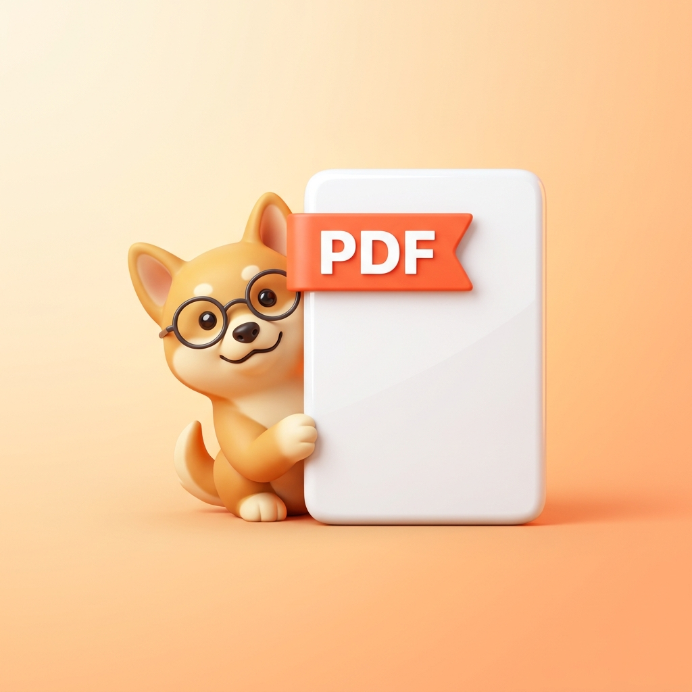

<p align="center">
  
</p>

<h1 align="center">🐶 Dog PDF</h1>

<p align="center">
  <strong>แอปแปลงไฟล์ ย่อขนาดไฟล์ รวม PDF ถอดเสียง และแปลเอกสารแบบออฟไลน์ 100% สำหรับ macOS</strong><br/>
  ลากไฟล์ใน Finder + กดปุ่มลัดเพื่อเรียกวงล้อแปลงไฟล์ หรือวางในหน้าต่างแอป พร้อมน้องหมาดุ๊กดิ๊กบน Menu Bar
</p>

---

## ✨ จุดเด่นของ Dog PDF

- 🔒 **ออฟไลน์และเป็นส่วนตัว 100%:** ทุกไฟล์ประมวลผลในเครื่อง Mac ของคุณทั้งหมด ไม่มีการอัปโหลดไฟล์ขึ้นเซิร์ฟเวอร์ภายนอก ไม่ต้องสมัครสมาชิก ไม่เสียค่ารายเดือน
- 🎯 **วงล้อลากปล่อยใน Finder:** แค่ลากไฟล์ใน Finder แล้วกด `Shift` ค้างไว้ วงล้อคำสั่งจะเด้งขึ้นมาตรงเมาส์อัตโนมัติตามประเภทไฟล์ที่เลือก
- 🪟 **ใช้งานได้ทั้ง 2 แบบ:** จะลากไฟล์เรียกวงล้อใน Finder หรือเปิดหน้าต่าง **Dog PDF** เพื่อวางใน Drop Zone / กดเลือกไฟล์ก็สะดวก
- 🛡️ **ปลอดภัยกับไฟล์ต้นฉบับ:** ไฟล์ผลลัพธ์จะถูกบันทึกไว้ **ข้าง ๆ ไฟล์เดิม** พร้อมเติมชื่อต่อท้ายอัตโนมัติ (เช่น `(compressed)`, `TH`, `EN`, `Merged`) ไม่เขียนทับหรือลบไฟล์เดิม
- 🐕 **มาสคอตน้องหมาดุ๊กดิ๊ก:** น้องหมาบน Menu Bar จะกระดิกหาง/กะพริบตาตอนว่าง วิ่งเร่งความเร็วตอนกำลังแปลงไฟล์ และกระโดดพร้อมหัวใจเมื่องานเสร็จ

---

## 🛠️ ทำอะไรได้บ้าง? (รองรับไฟล์ทุกสายงาน)

| ประเภทไฟล์ | นามสกุลที่รองรับ | คำสั่งบนวงล้อ / ในแอป |
|---|---|---|
| **🖼️ รูปภาพ** | `.jpg`, `.jpeg`, `.png`, `.webp`, `.heic`, `.tiff`, `.bmp` | `JPG`, `PNG`, `WEBP`, `PDF`, **`Compress`** *(ลดขนาด)*, **`Merge PDF`** *(เมื่อเลือก 2 รูปขึ้นไป)* |
| **📄 PDF** | `.pdf` | **`Compress`** *(ลดขนาด PDF)*, `JPG`, `PNG` *(แยกทุกหน้าเป็นโฟลเดอร์ `_pages`)*, `DOCX`, `TXT`, `→TH`, `→EN`, **`Merge PDF`** *(รวม PDF หรือรวม รูป+PDF)* — **มี Apple Vision OCR ออฟไลน์อัตโนมัติ** สำหรับ PDF ภาพสแกน |
| **📝 เอกสาร** | `.docx`, `.doc`, `.rtf`, `.txt`, `.html`, `.md` | `PDF`, `DOCX`, `TXT`, `RTF`, `HTML`, `→TH`, `→EN` *(รองรับภาษาไทยสมบูรณ์ และใช้ LibreOffice อัตโนมัติถ้ามีในเครื่อง)* |
| **🎬 วิดีโอ** | `.mov`, `.mp4`, `.mkv`, `.m4v`, `.webm`, `.avi` | `MP4`, `MOV`, `MP3`, `M4A`, `GIF`, **`Transcribe`** *(ถอดเสียงเป็น `.txt` + `.srt`)*, **`Compress`** *(ย่อขนาดด้วย Apple Silicon Hardware)* |
| **🎵 เสียง** | `.mp3`, `.m4a`, `.wav`, `.aac`, `.flac`, `.ogg` | `MP3`, `M4A`, `WAV`, **`Transcribe`** *(`.txt` + `.srt`)*, **`Compress`** *(ลดบิตเรต)* |
| **💬 ซับไตเติล** | `.srt` | `→TH`, `→EN` *(แปลเฉพาะบทพูด โดยเก็บเลขคิวและ Timestamp เดิมไว้ครบ)*, `TXT` |

> **หมายเหตุกรณีลากหลายไฟล์ต่างประเภทปนกัน:**
> - **รูปภาพ + PDF:** สามารถใช้ **`Merge PDF`**, **`Compress`**, **`JPG`**, **`PNG`** รวมกันได้ทันที
> - **ไฟล์ประเภทอื่นปนกัน:** วงล้อจะแสดงเฉพาะคำสั่งที่ใช้ได้กับ **ทุกไฟล์** ที่เลือกพร้อมกัน (เช่น วิดีโอ + รูปภาพ จะแสดง `Compress`) หากไม่มีคำสั่งที่ใช้ร่วมกันได้จะขึ้นแจ้งในวงล้อและไม่ทำงานผิดพลาด

---

## 💻 ความต้องการของระบบ

- **ระบบปฏิบัติการ:** macOS 15.0 (Sequoia) ขึ้นไป *(แนะนำ macOS 26+ สำหรับฟีเจอร์แปลเอกสารออฟไลน์ Apple Translation)*
- **ชิป:** แนะนำ Apple Silicon (M1 / M2 / M3 / M4 ขึ้นไป)
- **เครื่องมือสร้างแอป (ไม่ต้องลง Xcode ตัวเต็ม):**
  - Xcode Command Line Tools (`Swift 6`)
  - [Homebrew](https://brew.sh)
  - `ffmpeg`, `imagemagick` *(สำหรับแปลง/ย่อขนาดวิดีโอ รูป และสร้าง GIF)*
  - `whisper-cpp` + โมเดล GGML *(สำหรับฟีเจอร์ถอดเสียง `Transcribe` ออฟไลน์)*

---

## 📦 วิธีติดตั้งแบบละเอียด (ทีละขั้นตอน)

### ขั้นที่ 1: เตรียมเครื่องมือพื้นฐานบน Mac
เปิดแอป **Terminal** แล้วตรวจว่ามี Command Line Tools และ Homebrew หรือยัง:

```bash
# 1) ติดตั้ง Xcode Command Line Tools (ถ้ายังไม่มี จะมีหน้าต่างเด้งให้กด Install)
xcode-select --install

# 2) ติดตั้ง Homebrew (ถ้ายังไม่มี สามารถข้ามได้หากเคยลงแล้ว)
/bin/bash -c "$(curl -fsSL https://raw.githubusercontent.com/Homebrew/install/HEAD/install.sh)"
```

### ขั้นที่ 2: ดาวน์โหลดโค้ดและติดตั้งโปรแกรมเสริม
```bash
# โคลนโปรเจกต์ลงเครื่อง
git clone https://github.com/pooh23z/dog-pdf.git
cd dog-pdf

# รันสคริปต์ติดตั้ง ffmpeg, imagemagick, whisper-cpp และโหลดโมเดลถอดเสียง (ครั้งเดียว)
./scripts/setup-deps.sh
```
> 💡 **ตัวเลือกพื้นที่น้อย:** ถ้าอยากใช้โมเดลถอดเสียงขนาดเล็กลง (~500 MB แทน ~1.5 GB) ให้รัน `./scripts/setup-deps.sh --small` แทนได้ครับ  
> *(หากยังไม่ต้องการใช้ฟีเจอร์ถอดเสียงตอนนี้ สามารถลงแค่ `brew install ffmpeg imagemagick` ก่อน แล้วค่อยมากดปุ่ม **ติดตั้ง** ภายในแอปภายหลังได้)*

### ขั้นที่ 3: สร้างไฟล์แอป `Dog PDF.app` และติดตั้งลงเครื่อง
```bash
./scripts/build-app.sh
cp -R "dist/Dog PDF.app" /Applications/
open "/Applications/Dog PDF.app"
```
เพียงเท่านี้แอป **`Dog PDF`** ก็จะไปอยู่ในโฟลเดอร์ **Applications** พร้อมไอคอนน้องหมาและเปิดขึ้นมาใช้งานได้ทันที!

### ขั้นที่ 4: ตั้งค่าสิทธิ์ที่จำเป็นครั้งแรก (สำคัญมาก)
1. **สิทธิ์ควบคุมการลากไฟล์ใน Finder:**
   - เมื่อเปิดแอปครั้งแรก macOS จะเด้งถามสิทธิ์ **Accessibility / Device Control and Data Access**
   - กด **`Open System Settings`** → เปิดสวิตช์ให้ **`Dog PDF`**
   - *(หากเปิดแล้วจุดสถานะในแอปยังเป็นสีส้ม ให้กด **"รีเฟรชสถานะ"** หรือปิด-เปิดแอปใหม่อีก 1 รอบ)*
2. **โหลดแพ็กภาษาสำหรับแปลเอกสารออฟไลน์ (`→TH` / `→EN`):**
   - ไปที่ **System Settings → General → Language & Region → Translation Languages**
   - กดดาวน์โหลดภาษา **Thai (ไทย)** และ **English (อังกฤษ)** ลงเครื่องไว้ 1 ครั้ง (หรือกดปุ่ม **"ตั้งค่าภาษา"** ในแอปได้เลย)

---

## 🚀 วิธีใช้งานอย่างละเอียด

### วิธีที่ 1: ลากไฟล์ใน Finder เรียกวงล้อ (เร็วที่สุด เหมือนในคลิป)
1. เปิด **Finder** แล้ว **คลิกลากไฟล์** ที่ต้องการค้างไว้ *(เลือก 1 ไฟล์ หรือคลุมหลายไฟล์พร้อมกันก็ได้)*
2. ระหว่างที่ลากค้างไว้ **กดปุ่ม `Shift` บนคีย์บอร์ดค้างไว้**
3. **วงล้อสีส้มจะเด้งขึ้นมาตรงตำแหน่งเมาส์** ทันที
4. ลากเมาส์ไปวางบนช่องคำสั่งที่ต้องการ (ช่องจะสว่างเป็นสีส้มเข้ม) แล้ว **ปล่อยเมาส์**
5. **วิธียกเลิก:** ถ้าเปลี่ยนใจ ให้ปล่อยเมาส์ลงตรงกลางคำว่า **`Cancel`**, ลากออกนอกวงล้อแล้วปล่อย, หรือปล่อยนิ้วจากปุ่ม `Shift`

### วิธีที่ 2: ใช้งานผ่านหน้าต่างแอป / Drop Zone (ไม่ต้องกดปุ่มลัด)
1. เปิดแอป **`Dog PDF`** จาก Applications / Dock / Spotlight (`⌘ + Space` แล้วพิมพ์ `Dog PDF`) หรือคลิก **ไอคอนน้องหมาบน Menu Bar** ด้านบนขวา
2. **ลากไฟล์มาวางในกล่อง Drop Zone** หรือคลิก **"เลือกไฟล์จาก Finder…"**
3. ปุ่มคำสั่งที่ใช้ได้กับไฟล์นั้นจะแสดงขึ้นมา กดคลิกเพื่อเริ่มทำงานได้ทันที
4. หากกดปิดหน้าต่างหลัก (`×`) **แอปจะไม่ปิดตัวเอง** แต่จะซ่อนทำงานต่อบน Menu Bar (สามารถเรียกกลับมาโดยคลิกไอคอน Dock หรือปุ่มหน้าต่างใน Menu Bar)

### ⚙️ ความหมายของการตั้งค่าในแอป
- **เปิด/ปิดการทำงาน (สวิตช์มุมขวาบน):** เปิดหรือพักการจับการลากไฟล์ใน Finder ชั่วคราว
- **ปุ่มเรียกวงล้อ:** เลือกเปลี่ยนปุ่มที่กดค้างขณะลากไฟล์ได้ระหว่าง **`Shift ⇧`**, **`Option ⌥`**, หรือ **`Control ⌃`**
- **ระดับลดขนาด (`Compress`):**
  - `High Quality` — คุณภาพสูง ขนาดไฟล์ลดลงอย่างนุ่มนวล (วิดีโอคงความละเอียดเดิม, รูปคุณภาพ 90%, PDF 220 DPI)
  - `Balanced` *(ค่าเริ่มต้น)* — สมดุลระหว่างความคมชัดและขนาดไฟล์ (วิดีโอไม่เกิน 1080p HEVC, รูปไม่เกิน 2560px คุณภาพ 80%, PDF 150 DPI)
  - `Small` — เน้นประหยัดพื้นที่สูงสุด (วิดีโอไม่เกิน 720p, รูปไม่เกิน 1920px คุณภาพ 65%, PDF 110 DPI)
- **ภาษาถอดเสียง (`Whisper`):** เลือก `Auto` (ตรวจจับอัตโนมัติ), `ไทย (th)`, หรือ `English (en)`
- **เปิดหน้าต่างนี้เมื่อเริ่มแอป:** เลือกว่าตอนเปิดแอปให้แสดงหน้าต่างหลักทันทีหรือไม่
- **น้องหมาดุ๊กดิ๊กบน Menu Bar:** เปิด/ปิดแอนิเมชันน้องหมาบนแถบเมนูด้านบน

### 📂 ไฟล์ผลลัพธ์อยู่ที่ไหน?
ไฟล์ใหม่ทั้งหมดจะถูกสร้างไว้ **ในโฟลเดอร์เดียวกับไฟล์ต้นฉบับ** เสมอ และตั้งชื่ออัตโนมัติแบบไม่ทับไฟล์เดิม:
- ลดขนาดไฟล์ → `ชื่อไฟล์ (compressed).ext`
- รวม PDF → `ชื่อไฟล์แรก Merged.pdf`
- แปลง PDF หลายหน้าเป็นรูป → โฟลเดอร์ `ชื่อไฟล์_pages/page_001.jpg`
- ถอดเสียงวิดีโอ/เสียง → ได้ทั้ง `ชื่อไฟล์.txt` และ `ชื่อไฟล์.srt`
- แปลเอกสาร → `ชื่อไฟล์ TH.txt` หรือ `ชื่อไฟล์ EN.txt` *(สำหรับไฟล์ซับไตเติลจะได้ `ชื่อไฟล์ TH.srt` / `EN.srt`)*
- ถ้ามีชื่อซ้ำอยู่แล้ว ระบบจะเติม `(2)`, `(3)` ต่อท้ายให้โดยอัตโนมัติ

---

## ❓ คำถามที่พบบ่อย (FAQ)

<details>
<summary><strong>1. ลากไฟล์ใน Finder แล้วกด Shift แต่วงล้อไม่เด้ง?</strong></summary>

- ตรวจดูในหน้าต่าง `Dog PDF` ว่าสวิตช์เปิดใช้งานมุมขวาบนเปิดเป็นสีส้มอยู่
- ตรวจดูว่าแถว **สิทธิ์ Accessibility (จับลาก Finder)** เป็น **จุดสีเขียว** แล้วหรือยัง
- หากเพิ่ง build แอปใหม่แล้วเคยให้สิทธิ์เวอร์ชันเก่าไว้ macOS จะต้องให้ **ปิดแล้วเปิดสวิตช์ `Dog PDF` ใหม่ 1 ครั้ง** ใน `System Settings → Privacy & Security → Device Control and Data Access` (หรือ `Accessibility`) แล้วเปิดแอปใหม่

</details>

<details>
<summary><strong>2. แปลเอกสารแล้วแจ้งว่าไม่พบ Offline Translation Pack?</strong></summary>

Apple Translation ทำงานแบบออฟไลน์โดยใช้ชุดภาษาของ macOS เอง ให้ไปที่ **System Settings → General → Language & Region → Translation Languages** แล้วกดดาวน์โหลดภาษา **Thai** และ **English** ให้เรียบร้อย

</details>

<details>
<summary><strong>3. ถอดเสียง (`Transcribe`) แล้วแจ้งว่าไม่พบ `whisper-cli` หรือโมเดล?</strong></summary>

ให้กดปุ่ม **"ติดตั้ง"** ด้านหลังแถว Whisper ในแอป หรือรันคำสั่ง `./scripts/setup-deps.sh` ใน Terminal เพื่อให้ระบบลง `whisper-cpp` และดาวน์โหลดโมเดลลงที่ `~/Library/Application Support/MacWheel/Models/` จากนั้นกด **"รีเฟรชสถานะ"**

</details>

<details>
<summary><strong>4. อยากแปลงไฟล์ `.docx` ที่มีตารางหรือจัดหน้าซับซ้อนเป็น PDF ให้ตรงเป๊ะ 100%?</strong></summary>

โดยปกติแอปใช้ตัวแปลงของ macOS ในตัวโดยไม่ต้องลงโปรแกรมเพิ่ม แต่ถ้าเครื่องของคุณมี **LibreOffice** ติดตั้งไว้ (`brew install --cask libreoffice`) ตัวแอปจะตรวจพบ `soffice` และเรียกใช้แปลง `.docx → .pdf` แบบจัดหน้าสมบูรณ์ให้อัตโนมัติ

</details>

---

## 🧑‍💻 สำหรับนักพัฒนา (Development & Testing)

โครงสร้างโปรเจกต์แยกเป็น Swift Package 2 ส่วนชัดเจน:
- `Sources/MacWheelCore` — Logic ทั้งหมด (Routing, OutputPathResolver, ImageEngine, PDFEngine + Vision OCR, DocumentEngine, MediaEngine, TranslationEngine, JobExecutor, WheelGeometry, DogAnimationController)
- `Sources/MacWheel` — ส่วนติดต่อผู้ใช้บน macOS (AppKit / SwiftUI Menu Bar, Main Window, Radial Wheel Overlay, Progress HUD)
- `Sources/MacWheelTestsRunner` — ชุดทดสอบอัตโนมัติ (ทำงานได้ทันทีแม้เครื่องไม่มี Xcode.app ตัวเต็ม)

รันชุดทดสอบทั้งหมด:
```bash
swift run MacWheelTestsRunner
```

---

## 📄 License

เผยแพร่ภายใต้สัญญาอนุญาต [MIT License](LICENSE) — นำไปใช้งาน แก้ไข หรือพัฒนาต่อได้อย่างอิสระครับ 🐶✨
